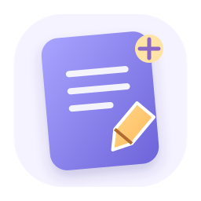
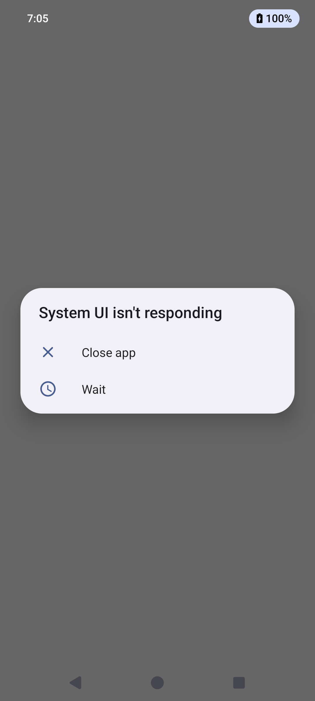

# ✨ Notes By Lavi

<p align="center">
  
</p>

<h1 align="center">Notes By Lavi</h1>
<p align="center"><strong>A calmer home for your thoughts.</strong><br/>Capture ideas, keep important things close, and organise your day — privately on your device.</p>

<p align="center">
  
  
  
  
  
  
</p>

<p align="center">
  <a href="https://github.com/hmmlavi/Notes/releases">Releases</a> ·
  <a href="https://github.com/hmmlavi/Notes/issues">Report a bug</a> ·
  <a href="https://github.com/hmmlavi/Notes/discussions">Ideas & feedback</a>
</p>

---

## 🌿 What is Notes By Lavi?

**Notes By Lavi** is an offline-first native Android notes app. It is being built around a simple idea: your notes should feel easy to capture, comfortable to read, and easy to find later.

The current codebase is an **early functional preview**, not the complete long-term vision. The features below are labelled honestly so you can see what works today and what is still planned.

## 📱 Real app screenshots\n\nThe screenshots below are captured from the running Android app on an Android emulator by GitHub Actions — they are not mockups. The screenshot is added automatically after the emulator job succeeds.\n\n\n\n> If this image is not present yet, the first automated emulator run has not completed successfully.\n\n## 🎯 Features available now

| Feature | What it does |
|---|---|
| ✍️ Quick notes | Create and edit text notes |
| 💾 Automatic local saving | Saves edits to the app's private SQLite database |
| 🔎 Search | Search note titles, body text and tags |
| 📌 Pinning | Keep important notes near the top |
| 🗂️ Archive | Hide notes without deleting them |
| 🗑️ Trash & restore | Move notes to Trash, restore them, or delete permanently |
| 🏷️ Tags | Add comma-separated tags to notes |
| 🔢 Word count | See the approximate word count while writing |
| 🌗 Appearance | Light canvas and pure-black AMOLED canvas option |
| 📵 Offline-first | Core note storage works locally without an account |

## 🧭 Product roadmap

These are **planned, not currently implemented**. The project will be developed in stages rather than claiming unfinished features are ready.

- [ ] A redesigned, polished note editor with formatting toolbar and better navigation
- [ ] Custom folders, nested collections, colours and note templates
- [ ] Checklists, tasks, reminders and calendar view
- [ ] Attachments, images, PDF/file support and a drawing canvas
- [ ] Import/export (Markdown, TXT, JSON) and user-controlled backups
- [ ] Optional accounts and multi-device sync
- [ ] Security review before any encryption or private-note security claims
- [ ] Offline writing assistance / grammar suggestions, with explicit user-controlled changes
- [ ] Windows desktop version with a shared data model and consistent experience
- [ ] Accessibility improvements, automated UI tests and device testing

### 🛡️ Privacy by design — current behaviour

- Notes are stored in the app's private local SQLite database.
- The current app does not provide account login or cloud sync.
- No end-to-end encryption claim is made.
- Uninstalling the app normally removes its private app data.
- **There is no built-in export/backup yet. Do not use this preview as the only copy of important information.**

## 📥 Download and install

### Option A — GitHub Release
Visit the **[Releases page](https://github.com/hmmlavi/Notes/releases)** and download the APK attached to the latest release, if one is published.

### Option B — Build from source
1. Install Android Studio and the Android SDK.
2. Install JDK 17.
3. Clone this repository.
4. Open the project in Android Studio and allow Gradle to sync.
5. Run the `app` configuration on an Android device or emulator.

To build from a terminal with Gradle available:

```bash
gradle testDebugUnitTest
gradle assembleDebug
```

The debug APK is generated at:

```
app/build/outputs/apk/debug/app-debug.apk
```

Install on a connected device with Android Debug Bridge:

```bash
adb install -r app/build/outputs/apk/debug/app-debug.apk
```

**Compatibility:** Android 8.0 (API 26) or later is configured as the minimum. The debug APK is for testing and is not a Play Store production-signed package. Test on your own device before storing anything important.

## 🧰 Technology

| Layer | Technology | Reason |
|---|---|---|
| Android app | Kotlin | First-class Android language and strong null-safety |
| UI | Jetpack Compose + Material 3 | Native, declarative Android UI |
| Local persistence | SQLite via Android SQLite APIs | Offline local storage |
| Build | Gradle Kotlin DSL | Reproducible Android builds |
| CI | GitHub Actions | Automated test/build workflow |

### Why Kotlin for the current app?

This repository currently targets **native Android**, so Kotlin is a sensible choice: it integrates directly with Android APIs and Jetpack Compose. Adding unrelated languages would not automatically make the app better. A proper Windows version is a separate milestone; we can evaluate Kotlin Multiplatform or Flutter/Dart when implementing that platform instead of pretending this Android-only code already runs on Windows.

## 🖥️ Windows desktop\n\nThe cross-platform workflow builds a Windows desktop bundle. Download the `Notes-By-Lavi-Windows-Desktop` artifact from the successful workflow run, extract the full folder, and run `notes_by_lavi.exe`. Keep the DLLs and data files beside the executable. This is an early preview and still needs testing on a Windows PC.\n\n## 🧪 Build checks

GitHub Actions is configured to run the Android test/build workflow and upload a debug APK artifact. A successful CI build confirms that the project compiles in that environment; it does **not** replace testing on real devices or prove that every UI flow is bug-free.

## 🗂️ Repository map

```text
.
├── .github/workflows/       # CI and release automation
├── app/
│   └── src/
│       ├── main/
│       │   ├── java/com/lavi/notes/  # Android app and local database
│       │   └── res/                 # App resources and launcher icon
│       └── test/                    # Unit tests
├── assets/                  # Project branding
├── CHANGELOG.md
├── CONTRIBUTING.md
├── SECURITY.md
├── LICENSE
└── README.md
```

## 🧑‍💻 Contributing

Bug reports, reproducible steps, accessibility feedback and thoughtful feature proposals are welcome. Please read [CONTRIBUTING.md](CONTRIBUTING.md) before opening a pull request. For security-sensitive reports, see [SECURITY.md](SECURITY.md).

## 🗺️ Release status

- **Current line:** 1.0.0 early preview
- **Stability:** Initial functionality; real-device testing still required
- **Backup/export:** Not available yet
- **Cloud sync:** Not available yet
- **Windows app:** Flutter desktop build is being added; CI provides a Windows bundle when the workflow passes

See [CHANGELOG.md](CHANGELOG.md) for changes.

## 📜 License

Released under the [MIT License](LICENSE).

---

<p align="center">
  Made with care by <a href="https://github.com/hmmlavi">Lavi</a> · <strong>Notes By Lavi</strong>
</p>
